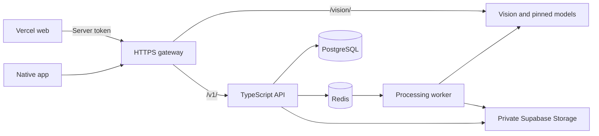

# Deploying the full AuraSpace application

The target includes learned furniture detection, metric-depth room drafts,
Big-LaMa removal and the native processing backend. Building the interface
alone does not deploy those services. Existing reconstruction limitations and
unfinished cloud-restore features remain as documented in the roadmap.

## The two observed Vercel errors

The Next.js build succeeded in both supplied logs.

1. `requests>=2.31.0` could not resolve because uv stopped at an older package
   on the PyTorch extra index. `services/vision/pyproject.toml` fixes this by
   assigning only Torch/Torchvision to the CPU index and keeping other packages
   on PyPI. The second log confirms Vercel now uses that manifest successfully.
2. `LAMBDA_SIZE_EXCEEDED`: the Python bundle is **1,022.14 MB**, above the
   standard **500 MB** Python function limit. Removing models/features or
   disabling reconstruction is not the deployment solution.

## Option A: keep web and vision on Vercel

The current `vercel.json` defines a Next.js `app` service and a private FastAPI
`vision` service. Keep the repository root (`.`) as Root Directory.

1. In **Project Settings → Environment Variables**, set
   `VERCEL_SUPPORT_LARGE_FUNCTIONS=1` for Production and Preview.
2. Ensure **Fluid Compute with Active CPU** is enabled. Redeploy the new commit
   without the previous build cache.
3. Vercel's [Large Functions beta](https://vercel.com/docs/functions/limitations#large-functions-beta)
   supports Python bundles up to **5 GB**. Its Python builder explicitly reads
   `VERCEL_SUPPORT_LARGE_FUNCTIONS`; this is a project build setting, not a
   frontend `NEXT_PUBLIC_*` value. Secure Compute and Static IP configurations
   currently do not support that beta.
4. Push the new source changes. The pyproject build script downloads all pinned
   model files into `services/vision/models` and verifies their SHA-256 hashes.
   The hosted `main.py` checks them and configures the detector, metric depth
   and LaMa paths. It fails startup if provisioning is incomplete. Generated
   weights stay out of Git; they are build outputs packaged with vision.
5. Retain the existing private binding that injects `VISION_SERVICE_URL` into
   Next.js. Do not set this to localhost or a laptop address. Vercel's
   [Services documentation](https://vercel.com/docs/services) explains this
   frontend/private-backend arrangement.
6. Open the site and `/api/health`, then test a real photo through detection,
   reconstruction and removal. Service connectivity alone does not establish
   successful model inference.

The shipped bundle will be larger than the reported 1,022 MB because that
build did not provision the roughly 468 MiB of local model assets.
The next hosted build must confirm the final size. Dependencies remain the
CPU Torch variants; the goal is to keep the full learned pipeline available.

Large function **disk capacity does not increase RAM**. Vercel currently lists
2 GB / 1 vCPU for Hobby and up to 4 GB / 2 vCPU for Pro/Enterprise. The actual
model peak memory and latency must be tested before choosing a plan. Do not
assume an upgrade is required solely from a disk-size error. If Large Functions
are unavailable or inference exceeds available resources, use Option B.

The web proxy now waits up to 180 seconds for inference; the browser waits 185
seconds, and the web route budget is 300 seconds on hosts honoring it. These
are bounded synchronous requests. Native jobs remain asynchronous. Web room
draft requests omit unused depth PNGs while still fitting raw metric depth,
reducing the response-size risk. Vercel's 4.5 MB payload limit still applies
to other outputs.

This two-service configuration hosts web and vision. Native queued processing
also requires API, worker, PostgreSQL, Redis and storage. Option B supplies that
backend as well; the current Vercel config does not declare those services.

## Option B: Vercel web with the full backend on a Docker server

`infra/compose.production.yml` supplies API, worker, PostgreSQL, Redis, vision,
model provisioning and a Caddy HTTPS gateway. It is separate from the local
Compose project and does not replace local database volumes. It requires a
Docker host with a public DNS hostname, ports 80/443 available, enough disk for
the images/assets/database, and capacity for the loaded models. Vision has a
configurable 4 GiB container memory limit by default; allow headroom for the
other services and OS, and measure peak usage. This is not a hardware guarantee.



### 1. Configure the server

Clone the repository onto the chosen server. Point a DNS record such as
`api.your-domain.tld` to it. In the server's single private root `.env`, configure
the existing Supabase settings and these deployment values:

```dotenv
POSTGRES_PASSWORD=<a-long-random-URL-safe-password>
REDIS_PASSWORD=<a-different-long-random-URL-safe-password>
SUPABASE_URL=https://YOUR_PROJECT_REF.supabase.co
SUPABASE_SERVICE_ROLE_KEY=<server-only-service-role-key>
SUPABASE_STORAGE_BUCKET=AuraSpace
WEB_ORIGIN=https://YOUR_WEB_PROJECT.vercel.app
API_DOMAIN=api.your-domain.tld
ACME_EMAIL=your-real-contact-address
VISION_API_TOKEN=<at-least-32-random-URL-safe-characters>
ALLOW_GUEST_SESSIONS=true
```

Generate each password/token independently, for example with
`openssl rand -hex 32`. Use URL-safe values because Compose embeds the database
and Redis passwords in their internal connection URLs. Optional OIDC settings
in the same file are forwarded to the backend; guest mode is the initial
demonstration path, not a completed enterprise account rollout.

Supabase Storage is the image/artifact store. PostgreSQL and Redis are supplied
by this Compose file with persistent volumes. Existing local data is not copied
to a new production database automatically.

### 2. Build and start on that server

Run from the repository root **on the deployment server**:

```bash
node --env-file=.env scripts/check-production.mjs
docker compose --env-file .env -f infra/compose.production.yml config --quiet
COMPOSE_PARALLEL_LIMIT=1 docker compose --env-file .env -f infra/compose.production.yml build
docker compose --env-file .env -f infra/compose.production.yml up -d
docker compose --env-file .env -f infra/compose.production.yml ps
```

The one-shot model task downloads/verifies assets into a persistent named
volume; repeated runs reuse valid files. Vision starts only after that task
succeeds, verifies the files again, and preloads the three models in one
process. The migration task runs the checked-in Prisma migrations before API
and worker startup. The worker starts after Redis and vision are healthy.
Caddy starts after API and vision health checks and provisions HTTPS.

Only gateway ports 80/443 are published. Database, Redis, API and vision use
the private Docker network. `/vision/*` requires the shared server token;
native `/v1/*` routes retain the existing API authentication. The worker reaches
vision privately. Secrets and generated models are not copied into Git.

Do not run `docker compose down -v` as an upgrade or retry step; it deletes
named data/model/certificate volumes. Updating source uses a rebuild and
`up -d`. Back up PostgreSQL and queue/storage before a real pilot; deployment
alone is not a tested disaster-recovery process.

### 3. Connect Vercel to the live backend

After the backend is reachable, change the frontend deployment to exclude the
Python bundle by copying the supplied alternative config:

```bash
cp infra/vercel.web-only.json vercel.json
```

Commit that config change and set these **server-only** Vercel variables:

```dotenv
VISION_SERVICE_URL=https://api.your-domain.tld/vision/
VISION_API_TOKEN=<the-same-token-as-the-backend-server>
```

No `NEXT_PUBLIC_*` token is needed. The Next.js proxy and health check forward
the token on the server. The frontend still performs detection, depth-based
room reconstruction and removal through the hosted backend. This config
change moves inference to the server; it does not remove those features.
The original two-service `vercel.json` is deliberately retained until this
alternative is selected and its backend is actually running.

### 4. Verify the full flow

Check `https://api.your-domain.tld/health` for database/queue readiness, then
the Vercel `/api/health` for vision connectivity. With a real photo, verify
furniture detection, room draft review/calibration/application and furniture
removal. The production vision container's model flags should reflect its
preloaded models; a failed model task or checksum prevents startup.

For the existing native app, set **Settings → Server URL** to the HTTPS API
origin without `/vision`. Exercise a guest session, upload, queued job, worker
completion and private result download. Rebuilding Android stays deferred.
Browser-local web rooms and native cloud projects remain separate clients;
deployment does not implement the unfinished cloud restore/sync features.

Inspect failures using Compose logs for `model-assets`, `migrate`, `vision`,
`api`, `worker` or `gateway`. A successful build, healthy HTTP server, downloaded
weight and actual inference are separate checks; do not describe the full
deployment as verified until the complete photo flow succeeds.

## What was checked locally

The latest cloud log confirms dependency resolution and the exact standard
bundle-size failure. The Large Functions opt-in is documented by Vercel and
checked by its Python builder. Local provisioning tests use tiny independent
fixtures to verify missing/corrupt asset rejection, streaming hashes and model
warmup staying in one process. The production Compose configuration and input
checker were validated without starting services. Real Docker image builds,
model provisioning and hosted inference remain to be run on the chosen host.
No local server stack, model loading or Android build was started for this work.
