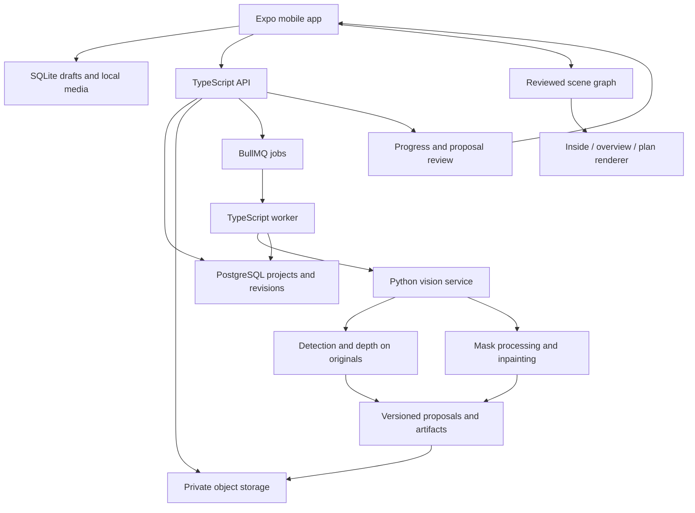

# Intelligent Room Capture, Furniture Extraction, and Spatial Design App

Mobile product and implementation plan — revised 25 October 2026.

This revision adopts the requested mobile flow: photograph a room, extract furniture into a sliding tray, generate an editable empty room, and arrange the furniture while viewing the room from inside. It replaces the earlier browser-first design. The original requirements for **image processing, computer vision, and computer graphics** remain central.

This is an implementation proposal. Accuracy, performance, and delivery estimates below are targets to validate, not existing results.

## 1. Product direction and main decisions

Build an Expo/React Native application for Android and iOS with a shared TypeScript scene model and a Python image/vision service. Prioritize a physical Android demonstration initially unless the available hardware suggests otherwise. The application must remain useful on an ordinary phone; LiDAR cannot be mandatory.

```text
Photograph or import a room, furnished or empty
  -> Review detected furniture and approximate room geometry
  -> Correct dimensions, boundaries, and missing items
  -> Extract furniture into a bottom sliding tray
  -> See an empty editable room and a processed-photo preview
  -> Place furniture from the tray
  -> Move, rotate, explicitly resize, and inspect from inside
  -> Compare layouts, save, and share
```

**Recommended stack:** Expo + React Native + TypeScript; Three.js through React Three Fiber's native renderer; a TypeScript API/job orchestrator; Python/FastAPI for vision and image processing.

**Rendering decision:** 3D is part of the core product because the user should feel present in the room. A top-down 2D plan remains essential for precise placement. Both views use the same scene data and must never become independently maintained layouts.

**Product quality decision:** Deliver a complete first release with persistent projects, recoverable processing jobs, editable estimates, clear uncertainty, and working fallbacks. Add specialist reconstruction and AR through capability-based extensions.

Initial boundaries:

- One room per project; rectangular rooms first, then orthogonal/L-shaped rooms.
- Automatic recognition initially covers chairs, sofas, beds, and dining tables.
- Other furniture is supported through user-labeled, dimensioned boxes.
- The initial reconstruction is a near-similar procedural room with approximate furniture models.
- A reference photo does not automatically become a complete, accurately textured 3D room.

## 2. Mapping the requested flow to implementation

| Requested behavior | Planned implementation | Limit and fallback |
| --- | --- | --- |
| Give room images with or without furniture | Guided camera capture and gallery import | Images without overlap remain references; they do not guarantee joint reconstruction |
| Remove furniture | Separate movable objects from the scene; generate masked, inpainted photo previews | Hidden walls/floor in previews are synthesized; preserve originals and allow mask correction |
| Keep furniture in a sliding panel | Persistent inventory in a bottom sheet with thumbnail cards | Review duplicate observations of the same physical item |
| Guess room/furniture size | Depth-assisted proposals, category priors, calibration, optional device scanning | All dimensions remain editable; ask for measurements when evidence is insufficient |
| Reproduce the room in 2D/3D | Parametric floor, walls, openings, materials, and furniture proxies | Approximate structural geometry first; detailed meshes later |
| Drag items into the room | Tap-to-place and long-press drag from tray, using floor-ray placement | Numeric positioning and 2D view remain available |
| Feel inside the room | Eye-level camera, look controls, tap-to-walk, lighting, shadows | Virtual walkthrough first; live-camera AR is a separate extension |
| Unknown item becomes a box | Name, width, depth, height, color, footprint | Clearly approximate representation, included in fit checks |
| Easy demonstration | Expo development build; installable preview APK for the presentation | Native scanning needs custom modules and compatible physical hardware |
| Enterprise direction | Versioned projects, durable jobs, ownership, private media, offline drafts, monitoring | Introduce infrastructure as the release needs it, with a manageable initial architecture |

## 3. Feasibility and scope

### Feasible in the first complete release

- Camera/gallery capture and multi-image projects.
- Furniture detection/segmentation, thumbnails, and a reviewed inventory.
- Photo furniture removal using selected masks and an inpainting model, with retry/correction.
- A correctable room draft using photos, approximate depth, and boundary/corner review.
- An empty procedural 3D room with editable dimensions and openings.
- Approximate furniture shapes, custom boxes, 2D placement, and an inside-room view.
- Move/rotate, collisions, undo/redo, saving, alternatives, and export.
- A useful planning workflow when any AI stage fails.

### Difficult but feasible as evaluated extensions

- LiDAR-based iOS room capture.
- Android depth-assisted measurement on supported devices.
- Irregular room reconstruction from guided captures with camera poses.
- Automatic identity matching across furniture views.
- Better object dimensions using calibrated cameras and visible depth surfaces.
- Consistent wall/floor texture recovery and AR preview.

### Beyond the first release's reliable scope

- Exact dimensions from arbitrary unrelated images without a scale reference or reliable sensor data.
- Exact hidden walls, furniture backs, or floor geometry beneath a sofa.
- Perfect furniture/shadow removal in every photograph.
- Production-quality, dimensionally accurate 3D furniture from any single photo.
- Real-time photorealistic reconstruction on every phone.
- Guaranteed globally optimal arrangements.

These limits determine when the app proposes a draft, requests correction, or uses a simpler representation. They do not prevent the intended product experience.

## 4. Expo, native rendering, and demonstrations

### Expo is a suitable choice

Our React/TypeScript skills transfer to React Native screens, state, forms, and networking. Use an **Expo development build** as the main environment. It accommodates our native dependencies and configuration, as explained in [Expo's development-build guide](https://docs.expo.dev/develop/development-builds/introduction/).

Expo Go is useful for early UI prototyping but is not the compatibility target for custom scanning modules or the final demonstration.

### Prove native rendering before committing to the full app

React Three Fiber supports React Native through `@react-three/fiber/native`, using Expo GL and assets. Follow its [native installation guide](https://r3f.docs.pmnd.rs/getting-started/installation#react-native) and [Expo GLView documentation](https://docs.expo.dev/versions/latest/sdk/gl-view/).

First verify on a physical target phone:

1. Floor, walls, and a procedural sofa render correctly.
2. Perspective and orthographic cameras work.
3. Touch selection, floor-ray placement, and camera movement work.
4. Bottom-sheet and viewport gestures do not conflict.
5. A scene preview can be captured/exported.
6. Background/resume and graphics-context recreation work.

Pin compatible Expo, React, React Native, Three.js, and Fiber versions based on that spike. Install Expo modules through `expo install`. Choosing the newest version of every dependency independently does not guarantee a compatible graphics stack.

Use native-supported Drei helpers selectively. Browser HTML labels, pointer-lock controls, DOM drag-and-drop, and browser canvas export code do not transfer directly. Dimension labels can use projected React Native overlays.

If the native stack fails its acceptance gate, evaluate a contained Three.js/WebView renderer before committing to that fallback. It needs its own bridge, gesture, memory, and export verification. Keep scene serialization independent of either renderer.

### Demo setup

- During development: install the development build and use Metro.
- For the demonstration: install a self-contained Android preview APK with its JS bundle included.
- Run the backend on a reachable laptop or hosted endpoint, with weights downloaded beforehand.
- On a phone, `localhost` is the phone; use the laptop's LAN address or a configured secure endpoint.
- Download an example project and clearly label saved analysis used during an outage. Demonstrate live analysis when available.

See [Expo's Android APK guide](https://docs.expo.dev/build-reference/apk/). iOS requires the appropriate build/signing/device setup; local iOS builds require macOS/Xcode, and cloud builds do not remove provisioning requirements.

## 5. Recommended technology stack

| Layer | Primary choice | Responsibility |
| --- | --- | --- |
| Mobile | Expo + React Native + TypeScript + Expo Router | Screens, routing, device lifecycle, builds |
| UI | React Native components and shared design tokens | Forms, cards, dialogs, accessible controls |
| Sliding tray | `@gorhom/bottom-sheet` + virtualized list | Collapsible inventory and item details |
| Gestures | React Native Gesture Handler + Reanimated | Camera/item manipulation and gesture ownership |
| Scene | `three`, `@react-three/fiber/native`, `expo-gl`, `expo-asset` | Perspective and orthographic rendering |
| Editor state | Zustand | Project, selection, tool mode, history |
| Server state | TanStack Query | Requests, job polling, caching, retries |
| Validation/forms | Zod + React Hook Form | Inputs, API responses, scene imports |
| Capture | `expo-camera`, `expo-image-picker`, `expo-image-manipulator` | Capture/import and upload-sized copies |
| Local records | `expo-sqlite` | Projects, revisions, pending operations |
| Local media | `expo-file-system` | Originals, thumbnails, downloaded assets |
| Session secrets | `expo-secure-store` | Session credentials |
| Sharing | `expo-sharing` + tested capture/export adapter | Images and portable project files |
| API | Node.js + TypeScript + Fastify | Projects, ownership, uploads, orchestration |
| Cloud records | PostgreSQL + Prisma | Users/workspaces, revisions, jobs |
| Async work | BullMQ + Redis + TypeScript worker | Stages, progress, retries, recovery |
| Vision | Python + FastAPI + PyTorch + Torchvision | Detection, masks, depth, model inference |
| Image processing | OpenCV + Pillow + NumPy | Orientation, masks, contours, colors, compositing |
| Inpainting | Pretrained LaMa, pinned/isolated runtime | Empty-room photo previews |
| Media storage | Private S3-compatible object storage | Sources, artifacts, exports |
| Testing | Vitest, React Native Testing Library, pytest, Maestro | Geometry, UI/API, vision, device flows |
| Optional desktop companion | Next.js | Admin/review UI or later desktop editor |

The tray is documented by [React Native Bottom Sheet](https://gorhom.dev/react-native-bottom-sheet/). Capture/storage use [Expo Camera](https://docs.expo.dev/versions/latest/sdk/camera/), [ImagePicker](https://docs.expo.dev/versions/latest/sdk/imagepicker/), [SQLite](https://docs.expo.dev/versions/latest/sdk/sqlite/), and [FileSystem](https://docs.expo.dev/versions/latest/sdk/filesystem/). Queue infrastructure is documented by [BullMQ](https://docs.bullmq.io/).

The previous React Konva, Dexie, and shadcn/ui choices applied to a browser app. They are not our main native stack. Reuse TypeScript domain logic rather than assuming browser UI runs unchanged on mobile.

### Manageable backend boundaries

Start with one TypeScript API, one worker, and one Python model service. Keep business logic in TypeScript and model-specific work in Python. Heavy processing runs off the phone and outside public request timeouts.

We do not need a service for every model or Kubernetes initially. An older inpainting dependency set may justify its own container without changing the public architecture.

## 6. Detailed mobile user journey

### A. Projects

Create/reopen a room, see processing state and last save, and choose capture/import/manual creation. Offer local guest use immediately and accounts for cloud sync in the pilot. Show whether a project is downloaded for offline editing.

### B. Guided capture

For ordinary photo mode:

1. Suggest approximately 6–12 overlapping views, adjusted to room size.
2. Guide coverage of corners, walls, openings, and floor.
3. Encourage movement between viewpoints, not only rotation from one spot.
4. Ask users not to move furniture during capture.
5. Allow furniture close-ups and gallery imports.
6. Accept smaller image sets while explaining that more correction may be needed.

These are capture instructions to evaluate, not a guarantee that a photo count ensures reconstruction. Flag blur, low light, duplicates, and incomplete coverage where possible.

Empty rooms normally produce no furniture detections; continue with room geometry and library/custom objects. A later “Scan with depth” option appears only on compatible hardware. Ordinary camera capture must not be labeled a metric scan.

### C. Review room draft

Show an editable outline and photo reference with width/depth/height, floor-corner handles, doors/windows, and surface color choices. Each inferred value carries its source and review status.

Ask for one measured wall length when available. Allow complete numeric room entry if estimates are incomplete. Keep missing boundaries unknown or visibly marked as placeholders.

Room edits create a new revision. If existing furniture ends up outside the room, flag it rather than silently shrinking the furniture or rescaling a measured item.

### D. Review furniture extraction

For each segmented thumbnail, allow:

- Keep as movable furniture or mark fixed.
- Correct category or label an unknown item.
- Merge observations of the same physical item.
- Split/refine masks, ignore false detections, or manually add a missed item.
- Review estimated width/depth/height and supply measurements.

A chair seen in five photographs should become one physical inventory item after identity review. Unknown items can have a thumbnail and box representation without a recognized category. Do not automatically remove windows, doors, built-ins, or structural fixtures.

### E. Empty room

Provide two distinct outputs:

1. **Editable room:** a procedural 3D shell with movable items initially in the tray.
2. **Photo preview:** selected furniture removed by masking/inpainting, with a before/after slider.

The scene becomes empty by removing furniture nodes; inpainting can finish independently. Label generated preview regions appropriately. Poor results permit mask correction, retry, or continuation with plain modeled surfaces.

### F. Arrange and experience

```text
+----------------------------------+
| Back  Room name       Undo  Save  |
| [Inside] [Overview] [2D plan]      |
|                                  |
|       Interactive room view      |
|                                  |
|       Selected item controls     |
|                                  |
+----------------------------------+
| Furniture tray / drag handle     |
| [Sofa] [Chair] [Bed] [+ Custom]   |
| Item details and dimensions      |
+----------------------------------+
```

- **Tap-to-place:** choose a card, see a ghost, tap a floor position, confirm.
- **Drag-to-place:** long-press a card, drag its ghost into the viewport, release to validate/confirm.

Tap placement is an equal primary interaction for small screens and accessibility. Collapse the tray enough to expose the room during placement.

Support selection, movement, rotation, explicit dimension editing, duplication as a new physical item, locking, and return-to-tray. Keep source photos and dimension provenance in the inspector.

### G. Alternatives and sharing

Save named layouts, compare conflicts/circulation, and save locally before cloud sync. Export a dimensioned plan, perspective screenshot, and portable project package. Keep editable scene data distinct from flattened images and avoid duplicating source photo storage for each layout.

## 7. Keep photos, room structure, and furniture separate

| Representation | Contents | Use |
| --- | --- | --- |
| Original observations | Photos, masks, scores, available camera metadata | Evidence, review, rerunning analysis |
| Processed photo previews | Selected regions replaced with synthesized pixels | Before/after visualization |
| Editable scene | Structural geometry, openings, independent objects, transforms, dimensions | Planning, walkthrough, fit checks |

An empty-room picture is not an editable 3D model. A mesh or texture with baked-in furniture also prevents clean rearrangement. Our scene uses a structural shell plus independent object nodes; whole furnished photographs must not be pasted onto walls as clean textures.

## 8. Image processing component

Implement and expose these stages in an analysis inspector:

1. Decode/validate, normalize EXIF orientation, preserve originals.
2. Generate bounded analysis images and record scale/crop mappings.
3. Maintain explicit RGB/BGR conversions.
4. Evaluate optional luminance CLAHE and conservative denoising.
5. Threshold masks while keeping raw model outputs.
6. Apply conservative mask opening/closing without merging neighboring objects.
7. Extract contours, centroids, image-space bounds, and masked color statistics.
8. Prepare removal masks with editable expansion and shadow regions.
9. Composite generated pixels into selected regions of the original.
10. Produce transparent thumbnails and before/after images.

OpenCV documents [CLAHE](https://docs.opencv.org/4.x/d5/daf/tutorial_py_histogram_equalization.html), [morphology](https://docs.opencv.org/4.x/d9/d61/tutorial_py_morphological_ops.html), and [contour features](https://docs.opencv.org/4.x/dd/d49/tutorial_py_contour_features.html).

Enhancement may reduce pretrained-model accuracy, so choose settings using an ablation. Preserve thin/disconnected object parts and raw masks. Image contour width/height remains a pixel measurement until valid calibration exists.

## 9. Computer vision models

### A. Initial detector/segmenter: Torchvision Mask R-CNN

Use COCO-pretrained **`maskrcnn_resnet50_fpn_v2`** as the initial server baseline, filtering chair, couch/sofa, bed, and dining table. Read actual checkpoint class metadata and map it to our categories. It is documented in the [official model reference](https://docs.pytorch.org/vision/main/models/generated/torchvision.models.detection.maskrcnn_resnet50_fpn_v2.html).

This changes the earlier YOLO11 default to better support evaluation of an enterprise distribution path. Torchvision has a [BSD-style code license](https://github.com/pytorch/vision/blob/main/LICENSE); its [pretrained-weight documentation](https://docs.pytorch.org/vision/stable/models.html) still requires reviewing weight and training-data terms. This is not blanket commercial clearance.

YOLO11n-seg/s-seg remains a possible latency comparison if its license fits the selected distribution. A separate inference service or ONNX export does not remove obligations; see [Ultralytics' licensing terms](https://www.ultralytics.com/license).

Keep an inference adapter returning our own labels/boxes/masks schema. Benchmark latency/memory before selecting production weights.

### B. Interactive refinement: SAM 2, after baseline masks

[SAM 2](https://github.com/facebookresearch/sam2) can refine a selected object from taps/boxes. It does not independently supply a furniture category or physical dimensions.

Start with brush/erase controls and baseline masks. Add a pinned SAM 2/2.1 checkpoint if it improves the user flow within the server budget. Keep prompts in the original oriented-image coordinate system.

### C. Approximate depth: Depth Anything V2 Metric Hypersim Small

Start with **`depth_anything_v2_metric_hypersim_vits.pth`**. The [official metric-depth instructions](https://github.com/DepthAnything/Depth-Anything-V2/tree/main/metric_depth) describe the indoor models. The [Small checkpoint card](https://huggingface.co/depth-anything/Depth-Anything-V2-Metric-Hypersim-Small) lists Apache-2.0 licensing.

This predicts metric depth; it is not a sensor measurement. Domain differences, reflective surfaces, unusual rooms, and camera assumptions can cause substantial errors. Evaluate it as a correctable draft generator.

Relative-depth and metric-depth checkpoints differ. A normalized relative-depth visualization cannot directly supply centimeters. Larger model variants also have different license terms; substitution needs checkpoint-specific review. See the [project license notes](https://github.com/DepthAnything/Depth-Anything-V2#license).

### D. Room structure: geometry-assisted estimation

Combine depth candidates, floor/wall/corner review, useful edge/line evidence, valid camera metadata, robust plane fitting, a rectangular/orthogonal prior, and user measurements.

If opposite boundaries are unobserved, room extent may remain unknown. Request a measurement or mark a placeholder instead of fabricating a confident dimension. No single selected model guarantees a full editable room from arbitrary images.

### E. Furniture appearance

Build procedural sofas, chairs, beds, and tables from simple meshes, adapting dimensions, color, and selected subtype. Cutouts remain inventory/reference images.

Single-image mesh generation is later R&D: generated assets need scale/orientation checks, cleanup, mobile optimization, and licensing review. They cannot automatically become authoritative collision geometry.

## 10. Furniture removal

### Photo previews: segmentation plus LaMa

Use pretrained **LaMa** from its [official repository](https://github.com/advimman/lama), with pinned weights and an isolated runtime if necessary.

```text
Original photograph
  -> user-reviewed movable-item masks
  -> union removal mask + controlled dilation/shadow corrections
  -> LaMa inference
  -> composite selected replacement region into original
  -> generated empty-photo preview and before/after slider
```

Extract thumbnails before removal and retain per-item masks. Preserve originals. Allow brush/erase correction and exclude structural/fixed items.

Large masks and complex shadows can produce invented/distorted surfaces. Independently inpainted photos need not agree across viewpoints. Do not use synthesized pixels as measured geometry evidence; geometry uses original observations and valid sensor inputs.

OpenCV inpainting can repair small mask defects but is not an equivalent large-sofa removal solution. Record exact code/checkpoint/dependency terms; the [LaMa code license](https://github.com/advimman/lama/blob/main/LICENSE) does not replace review of downloaded-weight provenance.

### Editable room: independent scene objects

Remove a movable object's node from the active placement list while preserving it in the tray inventory. The structural shell remains.

If a later raw scan contains furniture, segment it and fit/reconstruct clean structural surfaces before treating it as an empty editable room. Hiding a few known meshes does not clean an unsegmented scan.

## 11. Room reconstruction and physical scale

### Tier 1: ordinary photographs — required

1. Analyze images independently for furniture, approximate depth, and boundary evidence.
2. Select an appropriate primary view for the initial draft.
3. Ask for floor-corner/wall-boundary corrections where uncertain.
4. Estimate only dimensions supported by evidence and camera/depth assumptions.
5. Fit an editable simple shell, initially rectangular.
6. Allow complete manual/numeric correction and a known-length scale anchor.

With valid camera intrinsics and optical-axis depth:

```text
Xcamera = (u - cx) * Zcamera / fx
Ycamera = (v - cy) * Zcamera / fy
```

Optical-axis depth and distance along a ray are not interchangeable. Match the actual model/dataset convention. Update intrinsics after resizing/cropping. Approximate focal length adds uncertainty, and gallery photos may lack usable calibration.

The ordinary Expo camera/gallery workflow does not promise ARKit/ARCore tracking poses or calibrated depth. Those belong to a separately implemented native capture mode. Never silently assume sensor metadata exists merely because an image came from a phone.

Exclude furniture masks from candidate structural surfaces. Use floor seeds, robust plane fitting such as RANSAC, and valid gravity information when available. A NumPy implementation can fit plane candidates; Open3D is an optional tool for diagnostic point-cloud inspection. Blank walls, mirrors, occlusion, and missing boundaries need explicit failure handling.

Multiple photographs improve evidence coverage and inventory review immediately. Joint fusion requires poses/alignment; averaging unrelated depth maps is not a valid reconstruction method.

### Tier 2: guided capture with pose and scale — later

Collect overlapping frames with calibrated intrinsics, tracking poses, and available depth. Establish one coordinate system, reject poor frames, fit structural surfaces, and retain alignment quality.

Photogrammetry/structure-from-motion remains an R&D option. Textureless walls, repeated patterns, weak parallax, clutter, and scale ambiguity prevent an unqualified reliability promise.

### Tier 3: Apple RoomPlan — compatible-device extension

[RoomPlan](https://developer.apple.com/augmented-reality/roomplan/) uses camera/LiDAR on compatible iPhones/iPads for parametric room data, dimensions, and furniture types.

- Wrap capture in a local Swift Expo module.
- Convert surfaces, openings, object bounds, and transforms into our schema.
- Keep dimensions editable and retain scan provenance.
- Use structured geometry for our renderer; USD/USDZ exports need a tested conversion path and are not automatically Three.js runtime assets.
- Check capability at runtime.

This needs native code, suitable hardware, and a development build. It does not analyze arbitrary gallery photos or run on Android. Use [Expo Modules](https://docs.expo.dev/modules/overview/) for integration.

### Tier 4: Android ARCore depth — compatible-device extension

[ARCore Depth](https://developers.google.com/ar/develop/depth) provides depth on supported devices using motion and available sensors. It is not a complete Android equivalent of RoomPlan's semantic room export.

We need a native capture adapter, poses, depth integration, plane/layout fitting, and device evaluation. Query actual support and retain photo/manual mode.

### Dimension provenance and calibration

Store each value, unit, source, and review status. User measurements override proposals. A known wall length anchors scale only when associated correctly with the geometry; one length does not reveal all hidden dimensions.

Category priors are starting values, and accepting one does not make it measured. A four-point floor homography requires known coordinates on the same plane; it maps visible floor contacts, not tabletops, hidden corners, or furniture overhangs.

## 12. Furniture dimensions, identity, and custom boxes

Prefer dimension sources in this order:

1. User measurement/product specification.
2. Reviewed sensor/scan estimate.
3. Calibrated geometric estimate.
4. Model depth plus observable object evidence.
5. Category/subtype prior.
6. Explicit placeholder.

Track width, depth, and height separately. A known width does not imply known depth. Do not invent narrow numerical error bars before calibration supports them.

Illustrative priors include a 200 × 90 cm sofa, 50 × 55 cm chair, 160 × 200 cm bed, or 140 × 80 cm table, with editable heights. These are example defaults, not statistical predictions or standards.

Visible depth can support some dimensions; hidden depth/overhangs may remain unknown. Fall back per dimension rather than pretending the full box was observed.

### Inventory identity

- Observation: one detection in one image.
- Physical item: the actual sofa/chair, linked to multiple observations.
- Template: reusable geometry, such as our procedural sofa.
- Placement: one physical item's pose in one layout alternative.

Suggest merges using appearance/category and reliable geometry, with review where uncertain. Two identical-looking chairs are not automatically one chair.

Returning an item to the tray removes placement, not identity. Duplication creates another physical item record. Each physical item appears at most once per layout.

### Custom object flow

Enter a name, width, depth, and height; optionally attach a photo/mask, color, and fixed/wall-attached status. Render a labeled cuboid, include its footprint in validation, and support the usual movement/rotation/tray operations.

Unknown furniture must not block completion. Manual masking supports photo removal even when category recognition fails.

## 13. Computer graphics and inside-room interaction

### One scene and three cameras

- **Inside:** eye-level perspective; swipe to look, tap valid floor to walk, select/place furniture.
- **Overview:** orbit-style perspective with temporary wall/ceiling cutaways.
- **Plan:** orthographic top-down view with dimensions, footprints, snapping, and exact positioning.

Inside mode is a virtual walkthrough and needs neither VR nor live AR tracking. Provide reset view, speed/eye-height adjustment, and a stable plan alternative. Add a movement pad only if testing demonstrates a need.

### Coordinates and transformations

Store physical geometry in meters; display centimeters/meters.

- Right-handed scene: X right, Y up, Z along room depth; floor at Y = 0.
- Store an object's floor-footprint center; derive mesh vertical center from height.
- Normalize mesh origins, nominal dimensions, and front direction.
- Store yaw around +Y consistently. Convert clockwise plan angles to negative yaw with this axis mapping.
- Plan coordinates map to X/Z, with screen-down corresponding to +Z.

```text
p_clip = Projection * View * Translation * Rotation * Scale * p_local
```

Share pure TypeScript transforms/footprints between rendering, validation, and export.

### Room and object rendering

Render floor, walls, ceiling, real opening gaps, and independent furniture meshes. Use editable materials, broad colors from appropriate original regions, and approved/procedural textures initially.

Use modest lighting/shadows on the base device. Handle interior-facing wall surfaces, near-plane clipping, cutaway behavior, and ceiling occlusion. Do not imply that sampled colors reconstruct detailed hidden textures.

### Touch picking and placement

Convert viewport-relative touch coordinates to a camera ray and intersect the floor:

```text
ndcX = 2 * touchX / viewportWidth - 1
ndcY = 1 - 2 * touchY / viewportHeight

ray -> floor intersection -> candidate pose -> snap -> validate -> preview/commit
```

Account for safe areas, orientation, device pixel ratio, and sheet occlusion. Preserve the grab offset during dragging. Reject hits behind the camera, near-parallel rays, or touches outside the viewport. Eye-level placement may require aiming lower; offer plan/numeric alternatives.

Use explicit gesture ownership:

- Navigation swipes rotate the camera.
- Object movement pauses camera navigation.
- Rotation uses a handle/slider or 90-degree button.
- Tray scrolling never moves the camera or objects.
- Size changes require an explicit form and revalidation.

Show ghost placement, validity, and optional haptics. Revert invalid strict-mode drops or retain a visibly conflicted draft according to mode; never silently accept invalid geometry.

### Spatial constraints

- Rotation-aware footprint collision using the Separating Axis Theorem (SAT) for floor furniture.
- Room containment, fixed obstacles, and door sweeps.
- Boundary-edge checks for later concave rooms; corner inclusion alone is insufficient.
- Vertical intervals for later elevated/wall-mounted objects.
- Document conservative box footprints, including chairs under tables; add reviewed overrides/compound shapes later.
- Define touching-edge epsilon and separate clearance preferences.

Full rigid-body physics is unnecessary initially. Predictable positioning and dimension-based feedback are the priority.

Keep the walking camera within the room and outside expanded obstacles. Validate tap-to-walk paths instead of crossing walls/furniture.

### Classical CG evidence

Add an analysis screen for matrices, transformed corners, SAT axes, and a small outline drawn using our own Bresenham routine. The main CG contribution includes procedural geometry, scene hierarchy, projection, picking, clipping, lighting, and synchronized 2D/3D views.

## 14. Explicit evidence for all three academic components

| Component | Work | Demonstration evidence |
| --- | --- | --- |
| Image processing | Orientation, enhancement experiments, mask morphology, contours, removal-mask preparation, compositing | Original/processed images, histogram, raw/cleaned masks, before/after preview |
| Computer vision | Detection/segmentation, approximate depth, room-surface estimation, optional cross-view association | Boxes/classes/masks, depth map, room proposal, errors, quantitative evaluation |
| Computer graphics | Procedural room/assets, transforms, projections, picking, SAT, lighting, walkthrough | Inside/overview/plan views, touch placement, collisions, math overlays, exports |

Inpainting crosses disciplinary boundaries. Our image processing work still includes explicit classical pixel/mask operations; one model should not be presented as satisfying every requirement by itself.

Our contribution includes capture/review, processing, provenance, scene representation, geometry, interactions, integration, and evaluation. Identify pretrained architectures accurately rather than claiming to have invented them.

## 15. Public datasets and model development

### Dataset selection

| Dataset/source | Role | Access and limits |
| --- | --- | --- |
| COCO 2017 | Furniture detection/segmentation evaluation and optional adaptation | Public annotations/images; select four-category subset; no physical dimensions |
| Open Images V7 | Additional image-domain checks or future categories | Public subsets; verify class/mask availability |
| SUN RGB-D | RGB-D, room-layout, and object-geometry experiments | Public research benchmark; review constituent-data terms |
| Hypersim | Synthetic depth/geometry evaluation | Public rendered data; large download; separate code/data terms |
| Structured3D | Optional room-structure evaluation | Agreement/access process and dataset-specific terms |
| Our measured captures | Actual photo-to-room evaluation | Consented rooms, measurements, identity labels, room-level splits |
| Our paired synthetic scenes | Removal tests with known empty-room ground truth | Render the same procedural room with/without furniture |

### COCO 2017: primary furniture dataset

Use official instance annotations to select chair, couch, bed, and dining-table images. Download selected images, preserve all relevant masks/IDs, and generate manifests. Start at [COCO's official download page](https://cocodataset.org/#download).

Begin with roughly 300–500 relevant validation images if available; expand as practical. Adaptation uses a separate subset of the training split. A pretrained checkpoint can run without us training from scratch or downloading the entire dataset.

COCO does not provide our real furniture width/depth or hidden geometry. Its [terms of use](https://github.com/cocodataset/cocodataset.github.io/blob/master/dataset/termsofuse.htm) distinguish annotation licensing from photograph rights. Keep image provenance and license metadata.

### Open Images V7: supplementary

Use the [official download/format guide](https://storage.googleapis.com/openimages/web/download_v7.html) for class-filtered subsets. Additional data does not automatically extend a model's vocabulary. Check annotations, train an appropriate head/model, and evaluate new classes before claiming support. Boxes alone do not supervise a segmentation model's masks.

### SUN RGB-D and Hypersim: geometry

[SUN RGB-D](https://rgbd.cs.princeton.edu/) provides RGB-D and scene/object annotations suitable for testing geometry assumptions. Ordinary RGB uploads do not contain all those sensor inputs; separate sensor-assisted and RGB-only experiments.

[Hypersim](https://github.com/apple-aiml-research/ml-hypersim) provides synthetic indoor imagery/geometry. Download selected scenes and check its data/software terms. Convert depth conventions correctly; distance along a ray and optical-axis depth are not identical.

The proposed metric-depth checkpoint uses Hypersim training, so results there are an in-domain benchmark, not proof of independent real-room generalization.

### Structured3D: optional

[Structured3D](https://structured3d-dataset.org/) provides rendered imagery and structural annotations but requires an access agreement. Publicly described does not mean immediate or unrestricted commercial access. Do not make release-critical work depend on approval.

### Our local evaluation set

Target about 15–25 rooms and 80–150 usable images initially, subject to access and annotation effort. Include empty/furnished rooms, clutter, low light, reflective surfaces, unknown furniture, and repeat observations.

Record:

- Measured room width/depth/height and door locations.
- Measured furniture dimensions for a representative subset.
- Physical identities across views.
- Boxes/masks on a manageable annotation subset.
- Available camera/depth/pose metadata, without inventing missing calibration.
- Failure rates and corrections required to complete a project.

Split by physical room/item before tuning. Neighboring video frames or several views of one room must not cross development/final-evaluation splits.

### Paired synthetic removal data

Render our procedural room furnished and empty using identical camera/lighting. Retain masks, dimensions, and geometry. Compare inpainted outputs with actual empty renders to assess structure preservation and artifacts.

Use real captures to assess usefulness. For real paired furnished/empty photos, maintain camera position/settings or align them appropriately; unaligned pairs do not support naïve pixel-error comparisons.

### Model training and reproducibility

Start with pinned pretrained weights. Adapt after the full workflow works if assessment requires it or measured failures justify it:

1. Preserve complete annotations for all relevant instances.
2. Train on training data, select settings on development data, freeze final evaluation rooms.
3. Compare unchanged and adapted checkpoints on the same inputs.
4. Keep the baseline when adaptation does not improve the selected criteria.
5. Record data IDs/counts, splits, seeds, preprocessing, model hashes, and dependency versions.

We should not train detection, depth, inpainting, and room reconstruction from scratch simultaneously. A pretrained, evaluated pipeline is the viable initial route.

## 16. Enterprise architecture and asynchronous work



### Job dependencies

```text
Upload finalized
  -> validation and image preparation
  -> furniture observations and depth candidates
  -> room draft and inventory proposals
  -> user review/correction
  -> selected removal masks
  -> empty-photo generation
```

Editing can begin before photo previews finish. A mask edit should rerun the affected removal operation, not erase geometry/layout edits or repeat unrelated analysis.

Required behavior:

- Public requests quickly return a job ID rather than holding a mobile connection open for minutes.
- Persist stages, attempts, model/config versions, input revisions, artifact IDs, and actionable errors.
- Poll initially; real-time events are optional.
- Make retries idempotent so duplicate requests do not create duplicate items or unintended repeat inference.
- Bind outputs to capture/mask/scene revisions. Late output becomes a reviewable proposal.
- User-entered measurements and room edits take precedence over stale automatic estimates.
- Support cancellation at safe stage boundaries.
- Bound CPU/GPU concurrency and record queue delay separately from inference.
- Recover stalled jobs after worker restart using a tested lease/retry policy.
- Resume status by project/job ID after app suspension; do not assume mobile background execution continues.

Initially the TypeScript worker can call internal Python endpoints stage by stage. Keep the model service private, pass request IDs, and coordinate timeouts/retries so retrying a connection does not unknowingly duplicate a long GPU task.

## 17. Data model and project consistency

Use a renderer-independent scene schema. Suggested core types:

```ts
type DimensionSource =
  | "user-measured"
  | "product-specification"
  | "sensor-estimated"
  | "calibrated-estimate"
  | "model-estimated"
  | "category-prior"
  | "placeholder";

interface Dimension {
  meters: number;
  source: DimensionSource;
  reviewed: boolean;
  proposalId?: string;
  evidenceIds?: string[];
}

interface FurnitureObservation {
  id: string;
  captureImageId: string;
  modelVersion?: string; // absent for a fully manual selection
  originalLabel?: string;
  score?: number;
  boxPx?: [number, number, number, number];
  maskArtifactId?: string;
  coordinateSpace: "oriented-source-image";
}

interface PhysicalItem {
  id: string;
  name: string;
  category: "chair" | "sofa" | "bed" | "dining-table" | "custom";
  observationIds: string[];
  width: Dimension;
  depth: Dimension;
  height: Dimension;
  representation: "procedural" | "custom-box" | "approved-model";
  assetKey?: string;
  color?: string;
  movable: boolean;
}

interface Placement {
  physicalItemId: string;
  floorCenterXM: number;
  floorCenterZM: number;
  yawRad: number;
  locked: boolean;
}

interface RoomScene {
  schemaVersion: 2;
  revision: number;
  units: "meters";
  floorPolygonXZ: Array<[number, number]>;
  height: Dimension;
  boundarySource: DimensionSource;
  dimensionEvidence: Record<string, Dimension>;
  openings: Array<{
    id: string;
    kind: "door" | "window";
    wallIndex: number;
    offsetM: number;
    widthM: number;
    heightM: number;
    sillHeightM: number;
    source: DimensionSource;
    doorSwing?: "inward-start" | "inward-end" | "outward";
  }>;
  items: PhysicalItem[];
  layouts: Array<{ id: string; name: string; placements: Placement[] }>;
  activeLayoutId: string;
}
```

Validate polygons, positive finite dimensions, openings, IDs, and references. Retain original estimate evidence and later user changes for boundaries.

Each physical item appears at most once per layout. Unplaced movable items are in that layout's tray. Fixed items retain locked placements in every alternative; only an explicit fixture-edit action can alter them. Changing an item's physical dimensions affects its representation across alternatives; explain this in the inspector.

Additional records include workspace/project ownership, captures, media manifests, estimation proposals, artifacts/hashes, job stages, scene revisions, and audit events.

Local persistence uses SQLite plus persistent app document files. Saved projects must not rely on temporary caches. Durable artifact IDs identify remote media; expiring signed URLs are access mechanisms, not permanent identifiers.

## 18. API contracts

| Endpoint | Purpose |
| --- | --- |
| `POST /v1/projects` | Create project |
| `POST /v1/projects/:id/captures` | Create capture session |
| `POST /v1/captures/:id/uploads` | Create bounded upload intents |
| `POST /v1/captures/:id/finalize` | Verify uploaded inputs and create work |
| `POST /v1/projects/:id/jobs` | Request processing with revision and idempotency key |
| `GET /v1/jobs/:id` | Stages, errors, progress, partial outputs |
| `POST /v1/jobs/:id/cancel` | Request cancellation |
| `PATCH /v1/projects/:id/observations/:observationId` | Correct selection/class or fixed/movable status |
| `POST /v1/projects/:id/items/merge` | Reviewed identity merge |
| `POST /v1/projects/:id/inpaint` | Preview from an image and mask revision |
| `GET /v1/projects/:id/scene` | Fetch reviewed scene and revision |
| `PUT /v1/projects/:id/scene` | Save with expected base revision |
| `GET /v1/artifacts/:id/access` | Authorized short-lived media access |
| `POST /v1/projects/:id/exports` | Optional export/package generation |

Example job response:

```json
{
  "jobId": "job-001",
  "projectId": "project-001",
  "inputRevision": 3,
  "status": "running",
  "stage": "room-draft",
  "completedStages": ["validation", "furniture-observations"],
  "artifacts": [{ "id": "artifact-001", "kind": "furniture-mask" }],
  "warnings": ["The rear room boundary needs review."]
}
```

These are illustrative values. Show stage progress when inference exposes no trustworthy percentage.

Reject scene writes based on stale revisions and preserve the local draft for conflict resolution. Start with whole-scene revision checking. Multi-device sync is not the same feature as real-time collaborative editing; collaboration can follow later.

## 19. Offline use, privacy, reliability, and cost

### Interrupted/offline work

- Save scene changes locally immediately and debounce cloud writes.
- Edit downloaded rooms offline.
- Persist upload/sync operations and retry with backoff.
- Server jobs continue once upload finalization succeeds.
- Reopen by job ID; safely reissue expired upload URLs.
- Export manifests, scene JSON, and selected necessary assets, not expiring URLs.
- Track deletion/tombstones so an offline client cannot accidentally restore deleted media.

New server inference needs connectivity; an existing downloaded room does not.

### Private room data

Use private media storage, ownership checks, scoped access, TLS, retention/deletion controls, and bounded upload byte/pixel counts. Verify image content rather than extensions. Generate server-controlled file names.

For the pilot, integrate a maintained OpenID Connect identity provider rather than inventing password handling. Use an appropriate native authorization-code flow with PKCE, validate access tokens/audience on the API, and check workspace/project membership for every project and artifact operation. Local guest mode can remain available without an account.

Strip unnecessary metadata from shared copies while retaining geometry-relevant capture metadata only under the project's data policy. Do not log photographs, credentials, or signed URLs. Keep session credentials in [Expo SecureStore](https://docs.expo.dev/versions/latest/sdk/securestore/) and share via a tested path such as [Expo Sharing](https://docs.expo.dev/versions/latest/sdk/sharing/).

Using user photos for training requires a deliberate opt-in product flow. Track software, weight, dataset, and asset terms separately before shipping each capability.

### Operational reliability

- Safe structured logs with project/job correlation IDs.
- Per-stage timing, errors, retries, queue delay, and cancellation metrics.
- Distinct API health and model readiness/warmup.
- Version/config manifests attached to results.
- Feature flags for experimental capture/depth/inpainting.
- Backups and tested restore for durable records/media.
- Clear partial-result, failed-job, and ready-to-edit states.

### Hosting and costs

Cost drivers are inference time/GPU availability, source-image storage, artifacts/retention, and transfer. Normal room rendering happens on the phone.

Benchmark a CPU-compatible baseline first. A GPU can improve multi-model processing and may be needed for acceptable hosted latency. Do not assume free GPU hosting or a specific per-room price before selecting infrastructure and measuring workloads.

Bound photo counts, prepare smaller analysis copies, cache unchanged work by content/config, and expire replaceable intermediates. Pretrained models avoid mandatory paid per-image APIs; hosting still has a cost.

## 20. Layout feedback and optional arrangement intelligence

Core feedback covers overlaps, boundaries, fixed obstacles, door conflicts, and estimated dimensions. Include numeric positioning and dimensioned plan export.

Occupied/free area must use the union of in-room footprints. Initially, show sum-based footprint area only for valid, non-overlapping layouts and explain why it is unavailable for a conflicted draft. High occupancy alone does not imply a good arrangement.

Optional circulation module:

- User chooses passage width as a planning preference.
- Conservatively rasterize footprints.
- Expand obstacles by half that width and shrink the room boundary accordingly.
- Run BFS/A* from door to selected furniture access points.
- Prevent diagonal corner-cutting and document grid approximation.

Do not present example clearances as building-code/accessibility certification.

Optional suggestions can use bounded coarse-grid search, largest-item-first placement, several seeded restarts, and explainable access/preferences scores. Respect locked objects and report no feasible suggestion when necessary; do not claim a proven optimum.

## 21. Repository and implementation boundaries

```text
icgProject/
  PLAN.md
  README.md
  apps/
    mobile/
      app/                         # Expo Router
      components/
        capture/
        furniture-tray/
        room-review/
        scene/
        analysis-inspector/
      features/
        projects/
        jobs/
        inventory/
        editor/
        sync/
      storage/                     # SQLite and persistent media
      modules/                     # later Swift/Kotlin capture module
      tests/
    api/
      src/
        projects/
        captures/
        jobs/
        artifacts/
        auth/
      prisma/
    worker/
      src/                         # durable stage orchestration
  packages/
    contracts/                     # Zod schemas and API types
    scene-domain/                  # no React Native dependency
      transforms.ts
      footprints.ts
      sat.ts
      containment.ts
      door-sweeps.ts
      scene-validation.ts
      history.ts
    scene-assets/                  # procedural definitions and manifest
  services/
    vision/
      app/
        inference/
        preprocessing/
        masks/
        depth/
        room_draft/
        schemas.py
      scripts/
        prepare_datasets.py
        evaluate.py
      tests/
    inpainting/                    # isolated runtime if needed
  experiments/
    manifests/
    configs/
    reports/
  docs/
    architecture.md
    capture-guide.md
    evaluation.md
    model-manifest.md
    demo-script.md
  .env.example
  pnpm-workspace.yaml
  docker-compose.yml
```

Keep scene types/geometry platform-independent for a future desktop editor. Finish mobile before building that companion. Exclude private uploads, secrets, large datasets, and checkpoints from normal commits; retain manifests, scripts, hashes, and version locks.

## 22. Milestones and delivery gates

This mobile/3D/inpainting product is substantially larger than the earlier 2D browser plan. A rough allowance is 10–16 weeks of focused part-time work for a polished pilot, depending on hardware, skills, and validation. This is a planning estimate, not a guarantee; re-estimate after feasibility work.

| Phase | Work | Completion gate |
| --- | --- | --- |
| 0. Feasibility | Device rendering, gestures, placement/export; detection/depth/inpainting smoke tests | High-risk dependencies run on chosen hardware; versions/timings recorded |
| 1. Spatial foundation | Manual shell, three camera modes, tray, procedural items/custom boxes, collisions, local save | Useful room planner with working inside view |
| 2. Capture/inventory | Camera/gallery, persisted sources, async detection, mask review, identity/thumbnails | Empty and furnished captures both progress to inventory/editor |
| 3. Empty room | Scene extraction, mask editing, LaMa previews, before/after, retry/cancel | Furniture enters tray; editing continues even when restoration fails |
| 4. Room proposal | Metric-depth experiment, corner/plane review, calibration, numeric correction | Near-similar draft for supported photos and explicit manual recovery |
| 5. Complete first release | Place/move/rotate, alternatives, history, exports, device recovery | Full requested flow demonstrated end to end on a phone |
| 6. Pilot hardening | Accounts/ownership, private cloud storage, revision sync, recovery, monitoring/deletion | Small multi-user pilot is operable and debuggable |
| 7. Device extension | RoomPlan or ARCore based on available hardware | Native output maps correctly into our scene; errors measured |
| 8. Advanced R&D | Irregular rooms, fusion, better textures/meshes, AR, arrangement search | Each capability passes its own quality/performance gate |

Durable job behavior and access controls start when those backend capabilities are introduced. Phase 6 hardens them for pilot operation rather than delaying basic data protection until deployment. Model adaptation can accompany evaluation if required by the course.

**First complete release:** phases 0–5 include 3D and furniture-removal previews. Photo-based estimates can require correction; arbitrary captures do not receive a guarantee of fully automatic reconstruction.

**Enterprise pilot:** phase 6 is required before describing the product as an operational multi-user pilot. Infrastructure alone does not make geometric reconstruction accurate.

### First implementation session

1. Confirm physical devices and local Android build tools.
2. Create a development build with pinned native graphics versions.
3. Render a 4 × 3.5 m room and a 2 × 0.9 m sofa.
4. Add inside/plan cameras, tray placement, and a custom box.
5. Verify rotated overlap and room-boundary failures.
6. Run a room photo through the segmentation/depth models and LaMa with a selected mask.
7. Record latency/memory, visible failures, and unresolved compatibility issues before refining the schedule.

## 23. Evaluation and acceptance criteria

### Image processing and removal

- Orientation and image/model/UI coordinate mapping.
- Raw versus cleaned mask IoU on annotated samples.
- Enhancement ablation, including degraded cases.
- Error within removed regions and preservation outside masks on paired synthetic scenes.
- Wall/floor line continuity, residual furniture/shadows, and invented fixtures.
- Real-room correction effort and user-rated usefulness; plausible pixels do not establish hidden-surface truth.

### Computer vision and dimensions

- Per-class precision/recall and box/mask mAP where annotations support it.
- Missed/false items and corrections per room.
- Identity merge/split errors if suggestions are enabled.
- Depth error using the correct convention.
- Room/furniture dimension error against measurements, broken down by source and capture tier.
- Failure/abstention rate, including rooms needing manual creation.

Separate public detection benchmarks, synthetic tests, and independent real rooms. Do not count user-entered measurements as AI accuracy, and do not tune on final test rooms.

### Graphics and geometry

- Identical dimensions/poses across inside, overview, and plan.
- Independently calculated transform and ray-placement fixtures.
- Rotated SAT, touching edges, boundary corners, snapping, and door sweeps.
- Camera-path containment and obstacle avoidance.
- No unwanted scene movement while scrolling the tray.
- Explicit size editing updates geometry and warnings predictably.
- Custom boxes receive the same constraint checks.
- Repeated undo/redo and export/import preserve values without drift.

### Mobile workflow and persistence

- Complete capture → review → empty room → tray → placement → reopen → share.
- Empty rooms, no detections, unknown furniture, poor inpainting, and denied camera access.
- Interrupted uploads, slow/offline networks, duplicate requests, worker crash, and app suspension.
- Late model output cannot overwrite newer dimensions/layouts.
- Saved media survives cache cleanup because it is persisted appropriately.
- Conflicts preserve local edits and are visible to users.
- Private project/artifact access fails across users.
- Readable controls plus tap/numeric alternatives on small phones.

### Performance targets to measure

- At least 30 FPS for a representative 20-item procedural scene on the named base phone.
- Separate 50-item stress tests for memory, thermals, and lifecycle stability.
- Immediate local placement feedback without server dependency.
- Durable stage progress, with cold/warm detection, depth, inpainting, queue delay, and transfer measured separately.
- Multi-image processing may take tens of seconds or longer depending on hardware. Set a realistic target after the spike rather than promising instant scans.

Use physical Android hardware and, when available, an iPhone. Emulator/desktop success does not validate native graphics, capture, or touch usability.

Ask approximately 5–8 people to capture a room and place several items. Record time, correction count, navigation/gesture failures, and whether they understood estimated dimensions. Compare inside and plan placement before polishing assumptions into the interface.

## 24. Risks and fallback behavior

| Risk | Product response |
| --- | --- |
| Missing room boundaries | Additional view, corner edits, measurements, manual shell |
| Incorrect learned scale | Visible provenance, known-length calibration, numeric overrides |
| Unsupported furniture | Manual selection plus labeled dimensioned box |
| Duplicate observations | Reviewed physical-item grouping |
| Distorted hidden regions after removal | Generated preview label, mask edit/retry, plain modeled surfaces |
| Furniture baked into scan | Structural fitting separate from movable objects |
| Native graphics incompatibility | Physical-device spike, pinned versions, evaluated renderer fallback |
| Conflicting mobile gestures | Explicit modes and gesture ownership |
| Jobs outlive app session | Durable status, partial outputs, resume by ID |
| Late analysis overwrites corrections | Revision-bound proposals and user-value precedence |
| Expiring URLs break saved projects | Durable artifact IDs and persistent downloaded media |
| No LiDAR/depth support | Ordinary-photo mode and manual correction |
| Reconstruction consumes the schedule | Complete procedural-room flow before advanced R&D |

## 25. Demonstration, deliverables, and AI-assisted implementation

### Demonstration script

1. Open the installed app and capture/import a furnished room.
2. Show processing status and furniture observations.
3. Inspect preprocessing, masks, and depth output.
4. Correct one dimension and explain its provenance.
5. Extract selected furniture into the sliding tray.
6. Show the generated empty-photo preview and separate editable room.
7. Place a sofa while viewing from inside.
8. Switch to the plan, rotate/move precisely, and demonstrate a collision.
9. Add an unsupported object as a dimensioned box.
10. Return an item to the tray, save an alternative, reopen, and share/export.
11. Present evaluation/failures and device scanning only if implemented and tested.

### Deliverables

- Expo source/setup and installable demonstration build.
- TypeScript API/worker and Python services with reproducible local startup.
- Shared scene/geometry library, schema migrations, and meaningful tests.
- Dataset manifests, exact model provenance, and evaluation scripts/results.
- Processing/removal examples and dimension-error analysis.
- Demo projects, plan/perspective exports, and video.
- Architecture, capture guide, operational notes, report, and slides.
- Explicit implemented evidence for image processing, CV, and CG.

### AI-assisted work

The coding assistant can implement the interface, scene engine, geometry, APIs, jobs, model integration, dataset scripts, tests, and documentation in milestone order. The team still provides physical device access, real room photographs/measurements, signing credentials when needed, and actual hardware/cloud resources.

We can begin with ordinary photographs and procedural geometry without waiting for LiDAR. Prioritize the complete usable loop with correctable estimates, then improve reconstruction using measured results.

### Completion checklist

- [ ] Development/preview builds run on the selected physical phone.
- [ ] Capture/import supports furnished and empty rooms.
- [ ] Detection, mask review, manual extraction, and identity grouping work.
- [ ] Furniture leaves the scene and remains in the tray.
- [ ] Removal previews support correction and transparent failure handling.
- [ ] Room proposals can be reviewed or replaced with manual geometry.
- [ ] All dimensions retain sources and are adjustable.
- [ ] Inside/overview/plan use one scene.
- [ ] Tap/drag placement, rotation, size editing, and return-to-tray work.
- [ ] Unknown objects work as dimensioned boxes.
- [ ] Constraints, saving, alternatives, and exports work.
- [ ] App suspension and late AI results cannot destroy current edits.
- [ ] All three academic components have algorithms and evaluation evidence.
- [ ] Enterprise pilot behavior is tested before multi-user release.
- [ ] Scanning/reconstruction claims match tested capabilities.
