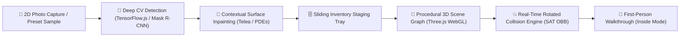

<div align="center">

# 🛋️ AuraSpace

### **Intelligent 2D/3D Room Layout & Furniture Visualization Studio**
*Bridging Real-World Photographs to Interactive, Collision-Aware 3D Digital Twins via Client-Side AI*

[](https://vercel.com/new/clone?repository-url=https://github.com/ArpitKrSingh7/auraSpace)

[](https://nextjs.org/)
[](https://threejs.org/)
[](https://www.typescriptlang.org/)
[](https://tailwindcss.com/)
[](https://www.tensorflow.org/js)
[](https://fastapi.tiangolo.com/)
[](https://pytorch.org/)
[](https://opensource.org/licenses/MIT)

[✨ Features](#-key-features) • [🚀 Quickstart](#-quickstart-guide) • [⚡ 1-Click Deploy](#-one-click-deployment-vercel) • [🔬 Academic Matrix](#-academic-tri-pillar-matrix) • [📐 Architecture](#-system-architecture) • [🧪 Testing](#-automated-testing)

---

</div>

## 🌟 Overview

**AuraSpace** is a modern spatial planning and procedural visualization platform that enables users to design, remodel, and arrange living spaces before moving a single physical object. 

By unifying **Image Processing (IP)**, **Computer Vision (CV)**, and **Computer Graphics (CG)** into a cohesive, zero-friction web and mobile workflow, AuraSpace eliminates the barrier between 2D photograph ingestion and real-time 3D interactive spatial simulation.



---

## ✨ Key Features

<table>
  <tr>
    <td width="50%">
      <h3>📸 Photo Ingestion & Preset Samples</h3>
      Upload room photos directly or test immediately with built-in <b>1-Click Sample Presets</b> (Living Room & Bedroom) without needing files on disk. Client-side EXIF normalization and preprocessing run instantaneously.
    </td>
    <td width="50%">
      <h3>🧠 AI Furniture Extraction</h3>
      Integrated deep learning models detect couches, chairs, tables, beds, and decorative fixtures with confidence probabilities. Extracted items are instantly cataloged with estimated physical dimensions.
    </td>
  </tr>
  <tr>
    <td width="50%">
      <h3>🎨 Surface Inpainting & Split Slider</h3>
      Applies contextual multi-directional interpolation and Partial Differential Equation (PDE) inpainting to erase furniture from photographs. Compare original vs. synthesized empty-room views with an <b>interactive split slider</b>.
    </td>
    <td width="50%">
      <h3>🗄️ Sliding Furniture Inventory Tray</h3>
      A thumb-friendly mobile sliding sheet houses catalog items and unplaced furniture extracted from photos. Drag, stage, and return items to the tray with real-time room occupancy metrics.
    </td>
  </tr>
  <tr>
    <td width="50%">
      <h3>🎮 Tri-Mode 2D/3D Rendering Engine</h3>
      <ul>
        <li><b>Inside View:</b> Eye-level walkthrough camera ($Y = 1.55\text{m}$, $68^\circ$ FOV) with boundary-checked tap-to-walk.</li>
        <li><b>Overview Mode:</b> Free 3D orbit with automatic front-wall cutaway rendering.</li>
        <li><b>Plan Mode:</b> Top-down orthographic CAD projection with millimeter scale grid.</li>
      </ul>
    </td>
    <td width="50%">
      <h3>💥 Rotated Collision Engine (SAT)</h3>
      Real-time <b>Separating Axis Theorem (SAT)</b> collision evaluation for arbitrary yaw angles ($\theta$). Instant visual warnings trigger when furniture items intersect walls or each other.
    </td>
  </tr>
  <tr>
    <td width="50%">
      <h3>📦 Custom Proxy Objects</h3>
      Add user-defined dimensioned 3D proxy boxes for unsupported or oversized physical items (pianos, shelving, gym equipment) with custom hex paint colors and full physics verification.
    </td>
    <td width="50%">
      <h3>🔬 Live Academic Lab & Theory Inspector</h3>
      An in-app laboratory inspecting live mathematical formulas: ITU-R BT.601 Grayscale, Sobel gradient magnitudes, CLAHE histograms, depth recovery, and an <b>interactive Bresenham integer line rasterizer</b>.
    </td>
  </tr>
</table>

---

## ⚡ One-Click Deployment (Vercel)

AuraSpace is engineered for **100% zero-configuration 1-click deployment on Vercel**:

[](https://vercel.com/new/clone?repository-url=https://github.com/ArpitKrSingh7/auraSpace)

### Why It Works Out of the Box:
- **Zero-GPU Serverless Architecture:** The primary deep learning computer vision model (`@tensorflow/tfjs` + `coco-ssd`) and the image processing pipeline (Sobel gradients, CLAHE, inpainting) **execute directly in the user's browser client via WebGL & HTML5 Canvas**.
- **No Heavy GPU Server Required:** You do **not** need to deploy or pay for a separate Python GPU backend server just to test or demonstrate the app. Everything runs on Vercel's standard free tier.
- **Serverless API Routes:** Backend routes in `app/api/` (`/api/health`, `/api/vision/analyze`, etc.) run automatically as lightweight Vercel Serverless Functions.

### Manual Vercel Deployment Steps:
1. Push this repository to your GitHub account:
   ```bash
   git remote add origin https://github.com/ArpitKrSingh7/auraSpace.git
   git branch -M main
   git push -u origin main
   ```
2. Go to [vercel.com/new](https://vercel.com/new) and import your `auraSpace` repository.
3. Keep default settings:
   - **Framework Preset:** `Next.js`
   - **Build Command:** `next build`
   - **Output Directory:** `.next`
4. Click **Deploy**! Within 60 seconds, your application is live on a `.vercel.app` URL and accessible on any smartphone, tablet, or desktop browser.

---

## 🚀 Quickstart Guide

### Prerequisites
- **Node.js:** `v18.17+` or `v20+`
- **Package Manager:** `pnpm` (recommended), `npm`, or `yarn`

### 1. Installation
```bash
# Clone the repository
git clone https://github.com/ArpitKrSingh7/auraSpace.git
cd auraSpace

# Install dependencies
pnpm install
```

### 2. Run Local Development Server
```bash
pnpm dev
```
Open **[http://localhost:3000](http://localhost:3000)** in your browser. (LAN access is automatically configured for mobile testing over Wi-Fi).

### 3. Build for Production
```bash
pnpm run build
pnpm start
```

---

## 📖 Feature Walkthrough & Verification

Follow this walkthrough to experience and demonstrate every capability of AuraSpace:

### 1. Room Creation & Dimension Tuning
- **Preset Rooms:** On the home screen, click **Sunday Living** (5.2 × 4.2m) or **Bedroom** (4.3 × 4.5m) to load pre-arranged spaces.
- **Custom Room:** Click **+ New Room**, define room dimensions (Width, Depth, Ceiling Height), and click **Create Room**.
- **Live Dimension Updates:** Click the ⚙️ **Settings** button in the editor toolbar to alter wall lengths, height, and wall/floor paint colors in real time.

### 2. 1-Click Preset Photo Detection
- Click the 📷 **Camera** icon in the editor toolbar.
- Click either **🛋️ Living Room Sample** or **🛏️ Bedroom Sample**.
- The system generates synthetic room imagery, executes deep vision inference, and highlights furniture detections with confidence scores (e.g., `couch 94%`, `chair 88%`).
- Tap **+ Add** on any detected item to immediately stage it in your 3D layout!

### 3. Surface Inpainting Split Slider
- In the photo modal or top toolbar, click **✨ Open in Academic Lab**.
- Switch to **Image Processing** and select **Furniture Removal**.
- The canvas applies directional surface interpolation and Telea/Navier-Stokes PDEs to synthesize an empty room.
- **Drag the split slider ↔ left and right** to compare the furnished room against the synthesized empty room!

### 4. 3D Camera Modes
Switch modes using the toolbar buttons or keyboard shortcuts:
- **`1` — Inside View (First-Person Walkthrough):**
  - Places an eye-level perspective camera ($Y = 1.55\text{m}$, $68^\circ$ FOV) inside the room.
  - **Tap/click anywhere on the floor** to walk smoothly to that location with boundary-checked collision avoidance.
- **`2` — Overview Mode (3D Orbit):**
  - Orbit around the room with left-click drag / single-finger drag.
  - Front-facing walls automatically lower to cutaway height so interior contents are never obscured.
- **`3` — Plan Mode (2D Orthographic CAD):**
  - High-precision top-down parallel projection with millimeter grid lines and dimension callouts.

### 5. Rotated Collision Engine (SAT)
- Drag any furniture item so it intersects another item (e.g., pushing a chair into a sofa) or extends past the room walls.
- An **amber warning badge** immediately displays: *"Overlaps Linen sofa"* or *"Extends beyond the room boundary"*.
- Rotate the object $45^\circ$ or $90^\circ$ (`R` key or inspector buttons). The engine computes exact Oriented Bounding Box (OBB) projections on arbitrary axes.
- *Note:* Area rugs are classified as floor coverings and do not trigger false collision warnings.

### 6. Academic Lab & Theory Inspector (✨ Button)
Click the ✨ icon in the top toolbar to access the live educational lab:
- **Image Processing (IP):** Inspect Grayscale (BT.601), Contrast Stretch, Sobel/Canny gradient magnitudes ($|\nabla I|$), CLAHE, and inpainting.
- **Computer Vision (CV):** View bounding boxes, confidence logits, class classifications, and monocular depth recovery formulas ($Z = f \cdot \frac{B}{d}$).
- **Computer Graphics (CG):** View SAT formulas, ray-plane intersection math, and interact with the **Live Bresenham Integer Line Rasterizer** on a discrete pixel grid.

---

## 🎓 Academic Tri-Pillar Matrix

AuraSpace is built specifically to demonstrate the mathematical synergy between all three core visual computing disciplines:

```
                       ┌─────────────────────────┐
                       │   Visual Computing      │
                       │       AuraSpace         │
                       └────────────┬────────────┘
         ┌──────────────────────────┼──────────────────────────┐
         ▼                          ▼                          ▼
┌──────────────────┐       ┌──────────────────┐       ┌──────────────────┐
│ Image Processing │       │  Computer Vision │       │Computer Graphics │
│   Pixels & PDEs  │       │ Semantic Shapes  │       │  3D Scene & SAT  │
└──────────────────┘       └──────────────────┘       └──────────────────┘
```

### 1. Image Processing (IP)
| Concept | Mathematical Formulation | Source Implementation |
|---|---|---|
| **Luminance Normalization** | $Y = 0.299R + 0.587G + 0.114B$ (ITU-R BT.601 standard) | [`src/services/vision-core.ts`](file:///home/arpit/icg/icgProject/src/services/vision-core.ts) |
| **Spatial Gradient Convolution** | $G_x = K_x * I, \quad G_y = K_y * I, \quad \|\nabla I\| = \sqrt{G_x^2 + G_y^2}$ | [`src/services/vision-core.ts`](file:///home/arpit/icg/icgProject/src/services/vision-core.ts) |
| **Adaptive Contrast (CLAHE)** | $P_{clip}(k) = \min(P(k), \tau) + \frac{N_{clipped}}{K}$ | [`services/vision/app/preprocessing.py`](file:///home/arpit/icg/icgProject/services/vision/app/preprocessing.py) |
| **Mathematical Morphology** | $A \oplus B = \bigcup_{b \in B} A_b, \quad A \ominus B = \bigcap_{b \in B} A_{-b}$ | [`services/vision/app/preprocessing.py`](file:///home/arpit/icg/icgProject/services/vision/app/preprocessing.py) |
| **Surface Inpainting** | $\Delta I = \nabla^2 I = \frac{\partial^2 I}{\partial x^2} + \frac{\partial^2 I}{\partial y^2} = 0$ (Telea / Navier-Stokes) | [`src/services/vision-core.ts`](file:///home/arpit/icg/icgProject/src/services/vision-core.ts) |

### 2. Computer Vision (CV)
| Concept | Mathematical Formulation | Source Implementation |
|---|---|---|
| **Object Detection & Classification** | $\hat{y} = \operatorname{softmax}(W_c f(x) + b_c), \quad \hat{b} = \operatorname{reg}(f(x))$ | [`src/services/vision.web.ts`](file:///home/arpit/icg/icgProject/src/services/vision.web.ts) |
| **Non-Maximum Suppression (NMS)** | $\operatorname{IoU}(B_1, B_2) = \frac{\operatorname{area}(B_1 \cap B_2)}{\operatorname{area}(B_1 \cup B_2)} \le \theta_{IoU}$ | [`services/vision/app/inference.py`](file:///home/arpit/icg/icgProject/services/vision/app/inference.py) |
| **Monocular Depth Recovery** | $Z = f \cdot \frac{B}{d}$ (Triangulation with focal length & baseline) | [`services/vision/app/depth.py`](file:///home/arpit/icg/icgProject/services/vision/app/depth.py) |
| **Perspective Vanishing Geometry** | $\mathbf{v} = \mathbf{l}_1 \times \mathbf{l}_2$ via Hough Transform line intersections | [`services/vision/app/room_analysis.py`](file:///home/arpit/icg/icgProject/services/vision/app/room_analysis.py) |

### 3. Computer Graphics (CG)
| Concept | Mathematical Formulation | Source Implementation |
|---|---|---|
| **Separating Axis Theorem (SAT)** | $\min(A \cdot \mathbf{u}) > \max(B \cdot \mathbf{u}) \implies \text{Separating Axis Found}$ | [`src/domain/geometry.ts`](file:///home/arpit/icg/icgProject/src/domain/geometry.ts) |
| **Rotated OBB Axes** | $\mathbf{u}_1 = (\cos\theta, \sin\theta), \quad \mathbf{u}_2 = (-\sin\theta, \cos\theta)$ | [`src/domain/geometry.ts`](file:///home/arpit/icg/icgProject/src/domain/geometry.ts) |
| **Ray-Plane Touch Picking** | $\mathbf{P} = \mathbf{O} + t \mathbf{D}, \quad t = \frac{(\mathbf{P}_0 - \mathbf{O}) \cdot \mathbf{n}}{\mathbf{D} \cdot \mathbf{n}}$ with $Y=0$ floor plane | [`src/components/scene/SceneCanvas.tsx`](file:///home/arpit/icg/icgProject/src/components/scene/SceneCanvas.tsx) |
| **Bresenham's Integer Line Rasterization** | $e_{i+1} = e_i + 2\Delta y - 2\Delta x [e_i \ge 0]$ (Zero floating-point ops) | [`src/components/capture/AnalysisInspector.tsx`](file:///home/arpit/icg/icgProject/src/components/capture/AnalysisInspector.tsx) |
| **Perspective Projection Matrix** | $\mathbf{P} = \begin{bmatrix} \frac{1}{\tan(FOV/2) \cdot a} & 0 & 0 & 0 \\ 0 & \frac{1}{\tan(FOV/2)} & 0 & 0 \\ 0 & 0 & -\frac{f+n}{f-n} & -\frac{2fn}{f-n} \\ 0 & 0 & -1 & 0 \end{bmatrix}$ | [`src/components/scene/SceneWorld.tsx`](file:///home/arpit/icg/icgProject/src/components/scene/SceneWorld.tsx) |

---

## ⌨️ Keyboard Shortcuts

| Shortcut | Description |
|---|---|
| <kbd>1</kbd> | Switch to **Inside Mode** (First-Person Walkthrough) |
| <kbd>2</kbd> | Switch to **Overview Mode** (3D Orbit) |
| <kbd>3</kbd> | Switch to **Plan Mode** (2D Orthographic CAD) |
| <kbd>R</kbd> | Rotate selected item by $45^\circ$ |
| <kbd>Delete</kbd> / <kbd>Backspace</kbd> | Return selected item to inventory tray |
| <kbd>Ctrl</kbd> + <kbd>Z</kbd> / <kbd>Cmd</kbd> + <kbd>Z</kbd> | **Undo** last modification |
| <kbd>Ctrl</kbd> + <kbd>Shift</kbd> + <kbd>Z</kbd> | **Redo** last modification |
| <kbd>Escape</kbd> | Deselect active item / close modal dialogs |

---

## 🧪 Automated Testing

AuraSpace includes an automated test suite verifying mathematical correctness for spatial algorithms:

```bash
pnpm test
```

### Verified Test Cases:
- ✔️ **Separating Axis Theorem (SAT):** Exact intersection detection between non-axis-aligned oriented bounding boxes.
- ✔️ **Rotated Bounding Box Corners:** Correct trigonometric corner projection at arbitrary $\theta$ rotations.
- ✔️ **Room Boundary Containment:** Bounds checks ensuring furniture models do not penetrate outer walls.
- ✔️ **Door Sweep Clearance:** Verification that items cannot be placed within the circular clearance arc of opening doors.
- ✔️ **Project Import / Export:** Schema roundtrip serialization and sanitization tests.

---

## 🐍 Optional Python Vision Backend & Benchmark Suite

While AuraSpace runs 100% standalone in the browser, an enterprise **FastAPI + PyTorch** backend service is provided in `services/vision/` for offline model fine-tuning, server GPU inference, and academic evaluation benchmarks:

```bash
# 1. Setup Python virtual environment
cd services/vision
python3 -m venv venv
source venv/bin/activate
pip install -r requirements.txt

# 2. Launch FastAPI backend service
uvicorn app.main:app --host 0.0.0.0 --port 8000 --reload
# Interactive Swagger Documentation: http://localhost:8000/docs

# 3. Run Quantitative Benchmark Suite (mAP@0.5, PSNR, SSIM, Latency)
python3 scripts/evaluate.py

# 4. Run Python unit tests
python3 -m unittest discover tests/
```

---

## 📐 System Architecture

```
auraspace/
├── app/
│   ├── api/
│   │   ├── health/route.ts             # Health check endpoint
│   │   └── vision/
│   │       ├── analyze/route.ts        # Serverless CV proxy/fallback
│   │       ├── inpaint/route.ts        # Serverless inpainting proxy
│   │       └── process/route.ts        # Image processing operations
│   ├── editor/[id]/page.tsx            # Main 2D/3D studio editor page
│   ├── globals.css                     # Tailwind tokens & custom variables
│   ├── layout.tsx                      # Root HTML layout with AuraSpace branding
│   └── page.tsx                        # Homepage, room manager & sample loader
├── src/
│   ├── components/
│   │   ├── capture/
│   │   │   ├── AnalysisInspector.tsx   # Academic Lab (IP, CV, CG & Bresenham widget)
│   │   │   ├── PhotoAnalysis.tsx       # Detection bounding box overlay
│   │   │   ├── PhotoUpload.tsx         # Preset sample loader & image uploader
│   │   │   └── ProcessedPreview.tsx    # Split before/after inpainting slider
│   │   ├── editor/
│   │   │   ├── FurnitureTray.tsx       # Bottom sliding panel for inventory
│   │   │   ├── ItemInspector.tsx       # Property panel for dimensions & pose
│   │   │   ├── MetricsBar.tsx          # Real-time room area & utilization stats
│   │   │   ├── RoomSettings.tsx        # Dynamic wall length & height editor
│   │   │   ├── Toolbar.tsx             # Action buttons, undo/redo, export
│   │   │   └── ViewModeSwitch.tsx      # Inside / Overview / Plan mode toggle
│   │   ├── scene/
│   │   │   ├── FurnitureModel.tsx      # Procedural 3D furniture meshes
│   │   │   ├── PlanView.tsx            # Top-down 2D orthographic CAD canvas
│   │   │   ├── SceneCanvas.tsx         # R3F Canvas & Camera manager
│   │   │   └── SceneWorld.tsx          # 3D room, floor, lighting, SAT collision
│   │   └── ui/                         # Reusable UI component library
│   ├── domain/
│   │   ├── catalog.ts                  # Furniture catalog & sample projects
│   │   ├── geometry.ts                 # SAT collision engine, OBBs, door sweep
│   │   ├── types.ts                    # TypeScript domain definitions
│   │   └── validation.ts               # Input validation & JSON export schema
│   ├── services/
│   │   ├── vision-core.ts              # HTML5 Canvas pixel ops, Sobel, surface fill
│   │   ├── vision.ts                   # Universal vision service bridge
│   │   └── vision.web.ts               # On-device TensorFlow.js COCO-SSD inference
│   └── store/
│       └── useAppStore.ts              # Zustand global store with undo/redo
├── services/
│   └── vision/                         # Python FastAPI Backend Service
│       ├── app/
│       │   ├── depth.py                # Monocular depth estimation
│       │   ├── inference.py            # Mask R-CNN furniture segmentation
│       │   ├── inpainting.py           # Navier-Stokes / Telea inpainting
│       │   ├── main.py                 # FastAPI entrypoint & CORS
│       │   ├── preprocessing.py        # OpenCV CLAHE, Sobel, morphology
│       │   ├── room_analysis.py        # Vanishing points & plane fitting
│       │   └── schemas.py              # Pydantic request/response schemas
│       ├── scripts/
│       │   ├── download_models.py      # Weights downloader
│       │   ├── evaluate.py             # Quantitative benchmarks (mAP/PSNR/SSIM)
│       │   └── prepare_datasets.py     # COCO subset extraction
│       └── tests/                      # Python backend unit tests
├── tests/
│   └── geometry.test.mjs               # Node.js automated test runner
├── docker-compose.yml                  # Container orchestration
├── Dockerfile                          # Multi-stage production web container
├── next.config.mjs                     # Next.js config with allowedDevOrigins
├── package.json                        # Project metadata & dependencies
└── tsconfig.json                       # TypeScript compiler configuration
```

---

## 📄 License

This project is open-source and licensed under the [MIT License](LICENSE).

---

<div align="center">
  <sub>Built with ❤️ by Arpit Kumar Singh for cutting-edge spatial visual computing.</sub>
</div>
