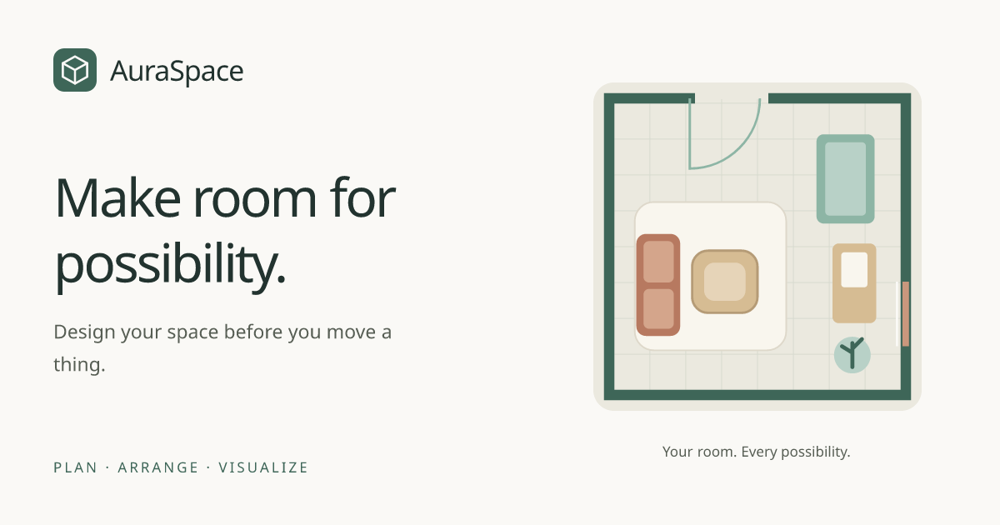

# AuraSpace

**Design your space before you move a thing.**

AuraSpace is a browser-based 2D and 3D room planner. Build a room from
measurements or use a photograph to explore an approximate room draft, then
arrange furniture and compare layouts from a floor plan, a 3D overview, or
inside the room.

[Live demo](https://auraspace-seven.vercel.app/) ·
[Getting started](#getting-started) ·
[Local setup guide](RUNNING.md) ·
[Deployment](DEPLOYMENT.md) ·
[Roadmap](PLAN.md)

## Features

- **Three ways to explore:** switch between floor-plan, 3D overview and inside
  views while working on the same layout.
- **Editable rooms:** set dimensions and finishes, add multiple doors and
  windows, and adjust their position, size, hinge, swing direction and angle.
- **Interactive furniture:** place, drag, rotate, resize and lock items, with
  grid snapping, overlap feedback and undo/redo.
- **Household furniture library:** choose from 19 categories, including beds,
  chairs, desks, wardrobes/almirahs, dressing tables, mirrors, split ACs,
  ceiling fans and storage. Use custom boxes for unusual objects.
- **Photo-assisted planning:** upload 1–5 views, detect supported furniture, review an estimated
  floor/wall draft and open a populated starting layout. Check the numbered
  detections, mark missed items, and enter room width/length in feet or metres.
  Overlapping views can share a floor frame; difficult views stay in a reference
  gallery and the best available view supplies the fallback draft.
- **Image tools:** inspect grayscale, contrast, edges and contours, and create
  approximate furniture-removal previews.
- **Save and compare:** keep alternative layouts in the browser, export an
  importable JSON project, download a dimensioned SVG plan or capture a PNG view.

Manual planning works without the Python service. Learned depth, room fitting
and Big-LaMa removal require the vision backend; browser-based furniture
detection and approximate removal fallbacks are also available.

## How it works

1. **Start a room.** Open a sample or create a project using room measurements
   or 1–5 photographs. One photo is enough to start. For better coverage, move
   around the room and take 3–5 overlapping views with floor, walls and some
   of the same furniture visible. Use the normal 1× camera.
2. **Review the estimate.** For photo-based planning, check detected furniture
   and the visible floor/wall draft. Uncheck wrong boxes, mark missed items,
   and enter room width and length if known.
3. **Make it yours.** Open the furnished draft, then adjust furniture sizes,
   positions, doors and windows. Supported depth supplies initial object poses;
   otherwise, positions are an explicitly labelled photo-composition guess.
4. **Try different layouts.** Move and rotate items, examine opening clearances,
   compare saved alternatives and export the result.

Photo reconstruction is experimental. Hidden room boundaries and exact object
dimensions cannot be reliably recovered from a single ordinary photograph.
All estimates remain editable.

Multi-photo alignment is experimental too. The backend uses OpenCV RootSIFT
matches, depth-backed similarity-transform RANSAC and reprojection/floor checks.
Only supported views contribute geometry; room dimensions from unrelated views
are never averaged. Repeated furniture is merged by category and spatial
proximity after alignment. This can still need correction. Unmatched views
remain available for checking or manually marking items, which start unchecked.
Analysis runs sequentially within a time budget; unprocessed photos remain
references. No additional model download, database or worker is required.

## Image processing, computer vision and computer graphics

AuraSpace combines three technical areas in one planning workflow:

| Area | Role in the project |
| --- | --- |
| Image processing | Pixel operations, contrast/CLAHE, edges, contours, histograms, selection masks and removal composition |
| Computer vision | Furniture detection/segmentation, learned indoor metric depth and geometric floor/wall fitting |
| Computer graphics | Procedural room/furniture meshes, lighting, cameras, picking, transforms, hinged doors/windows and 2D/3D visualization |

## Tech stack

| Layer | Technologies |
| --- | --- |
| Web application | Next.js App Router, React, TypeScript, Tailwind CSS |
| Interactive graphics | Three.js, React Three Fiber, Drei |
| State and persistence | Zustand, browser local storage, JSON import/export |
| Browser inference | TensorFlow.js and COCO-SSD |
| Vision service | Python, FastAPI, NumPy, OpenCV, PyTorch, Torchvision, Transformers |
| Pretrained models | Mask R-CNN ResNet50 FPN v2, Depth Anything V2 Metric Indoor Small, Big-LaMa |
| Deployment | Vercel web/vision services, with a Docker-hosted backend option |

Model download sources, pinned revisions and SHA-256 hashes are recorded in
[the model manifest](services/vision/model-manifest.json). The project uses
pretrained models; library furniture dimensions are editable category defaults.
Models and datasets retain their respective upstream licenses.

## Getting started

### Run the website

Use **Node.js 24+** and **pnpm**. From the repository root:

```bash
pnpm install --frozen-lockfile
pnpm dev
```

Open [localhost:3000](http://localhost:3000) and try a sample room or create your
own. Manual planning does not require an account, a database or model downloads.

For a production build:

```bash
pnpm build
pnpm start
```

### Enable the vision service

The Python service runs separately from Next.js and downloads large model
weights. Use **Python 3.12** and follow [RUNNING.md](RUNNING.md) for environment
setup, dependency installation and model provisioning.

For local server-backed analysis and removal, set these values in the root
`.env` before starting Next.js:

```dotenv
VISION_SERVICE_URL=http://127.0.0.1:8000
NEXT_PUBLIC_VISION_API_URL=http://127.0.0.1:8000
```

The web client sends service requests through `/api/vision`. Server credentials
belong in server-only environment variables. Once the Python environment and
weights are prepared, start vision in a second terminal:

```bash
bash scripts/vision-local.sh
```

The standard website-to-vision flow needs only these two processes. The optional
API, worker, PostgreSQL and Redis services are separate infrastructure.

For hosted environments, follow [DEPLOYMENT.md](DEPLOYMENT.md); a local backend
address is only suitable for local development.

## Project structure

```text
app/                    Next.js pages, metadata and server API routes
src/                    Web editor, scene, state and browser services
packages/scene-domain/  Shared room geometry, validation and layout logic
packages/scene-assets/  Procedural furniture models
packages/contracts/     Shared API schemas
services/vision/        Python image-processing and vision service
apps/api/               Optional cloud API
apps/worker/            Optional background processing worker
packages/backend/      Shared cloud-backend utilities
infra/                  Deployment and container configuration
scripts/                Setup, model provisioning and verification tools
tests/                  JavaScript and scene-interaction tests
.depreciated/mobile/    Archived Expo/Android prototype
```

The active application is the website. Mobile development is deferred; the
[archived prototype](.depreciated/README.md) is excluded from active workspace
installation and web builds.

## Verification

```bash
pnpm typecheck
pnpm test
```

With the Python environment prepared, also run the cross-language room-fitting
check:

```bash
pnpm verify:reconstruction
```

Scene tests exercise actual Three.js raycasting and event propagation with GPU
drawing stubbed. Synthetic geometry fixtures verify reconstruction behavior;
browser/device checks and measured real rooms are needed to assess visual
behavior and reconstruction accuracy.

## Current limitations

- Room reconstruction produces a partial, approximate draft. Automatic
  door/window detection, ceiling/height recovery and multi-photo fusion remain
  future work.
- Detector coverage is narrower than the furniture library. Unsupported items
  can be added manually with editable dimensions.
- Removal synthesizes hidden surfaces. Use the original photograph for geometry
  evidence and check dimensions against real measurements.
- Projects currently save in the browser. Clearing browser data can remove
  them; export JSON for a portable backup. Accounts, cloud restore and sync are
  not connected to the current web editor.

See [PLAN.md](PLAN.md) for implementation details and next priorities.

## Privacy and storage

Projects and imported photos are saved in the current browser. Photos used for
server-based AI analysis are sent to the backend for processing. The current
website does not automatically publish rooms or provide a central gallery of
uploaded projects. Clearing browser data can remove saved work. Exported JSON
projects include any saved photos, so sharing a project file shares that content.

## Contributing

Issues and pull requests are welcome. For bugs, include reproduction steps,
expected and actual behavior, browser/device details and, where useful, a
screenshot or a non-sensitive sample project. Run the relevant checks above
before submitting code changes.
